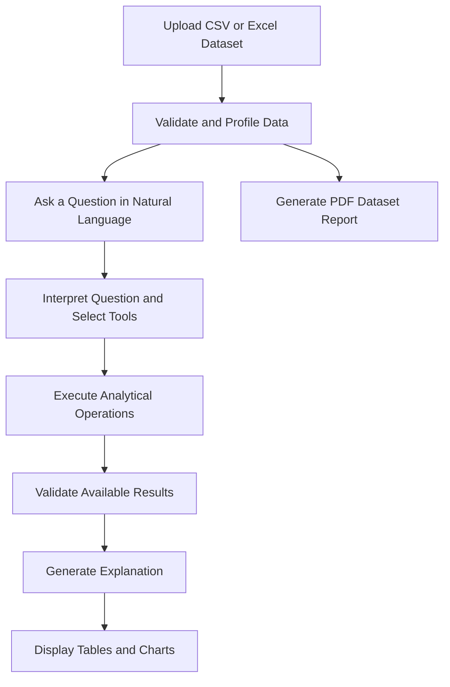
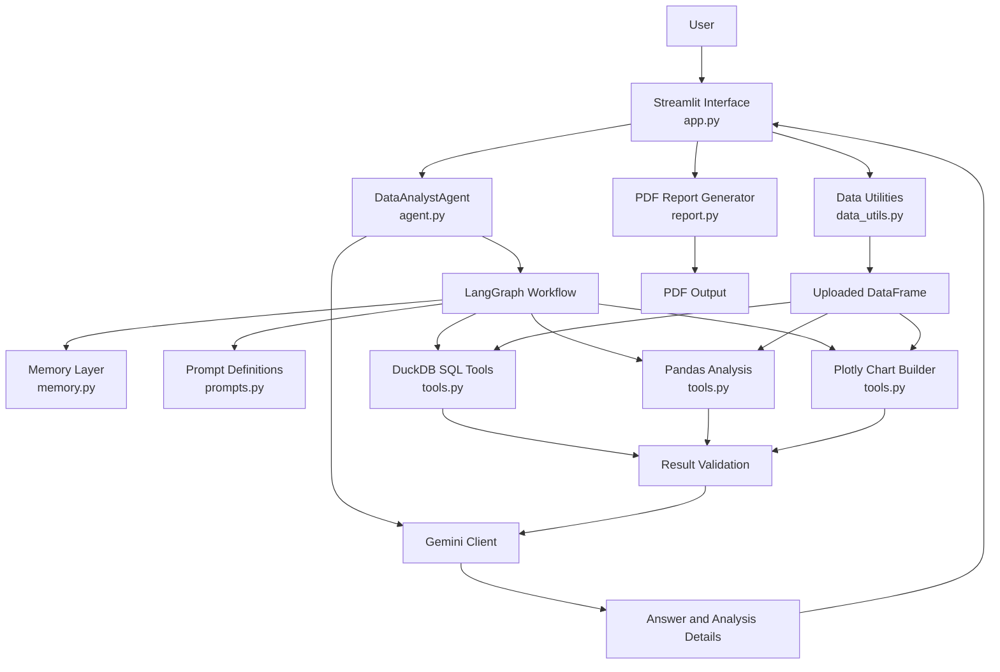
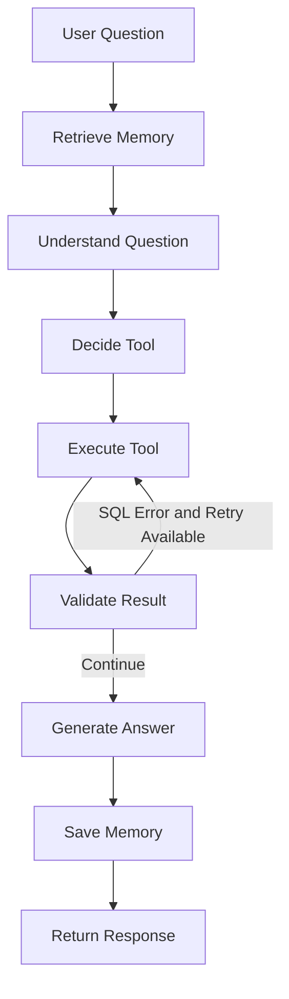

<div align="center">

# InsightForge AI

### From raw data to reasoned insights.

**An AI-assisted data exploration and analysis application that connects natural-language questions with programmatic analysis, interactive visualizations, and automated reporting.**

<br>

[Overview](#-overview) · [Architecture](#-system-architecture) · [Features](#-core-capabilities) · [Installation](#-getting-started) · [Limitations](#-limitations--engineering-considerations)

<br>

**Python** · **Streamlit** · **Google Gemini** · **LangGraph** · **DuckDB** · **Pandas** · **Plotly**

</div>

---

## Table of Contents

- [Overview](#-overview)
- [The Problem](#-the-problem)
- [What InsightForge AI Does](#-what-insightforge-ai-does)
- [Core Capabilities](#-core-capabilities)
- [System Architecture](#-system-architecture)
- [Agent Workflow](#-agent-workflow)
- [How the Analysis Works](#-how-the-analysis-works)
- [Memory and Context](#-memory-and-context)
- [PDF Report Generation](#-pdf-report-generation)
- [Technology Stack](#-technology-stack)
- [Getting Started](#-getting-started)
- [Configuration](#-configuration)
- [Using the Application](#-using-the-application)
- [Example Analytical Questions](#-example-analytical-questions)
- [Project Structure](#-project-structure)
- [Limitations and Engineering Considerations](#-limitations--engineering-considerations)
- [Security and Data Privacy](#-security-and-data-privacy)
- [Roadmap](#-roadmap)
- [Acknowledgements](#-acknowledgements)

---

## 🔎 Overview

InsightForge AI is an AI-assisted data analysis application designed to make dataset exploration more accessible through natural-language interaction.

Users can upload structured data, ask analytical questions in plain English, inspect the results, explore visualizations, and generate a PDF report describing the dataset.

The application combines an LLM-powered reasoning and orchestration workflow with programmatic analytical tools. Google Gemini helps interpret questions, select tools, generate SQL, and explain results. DuckDB and Pandas perform the underlying data operations, while Plotly provides interactive visualizations.

The application also uses conversation context to resolve follow-up questions and supports rule-based PDF report generation without requiring an additional LLM call for the report itself.

### At a glance

| Component | Description |
|---|---|
| Application interface | Streamlit |
| Natural-language interpretation | Google Gemini |
| Workflow orchestration | LangGraph |
| SQL analytics | DuckDB |
| Data processing | Pandas and NumPy |
| Interactive visualizations | Plotly |
| PDF reporting | ReportLab and Matplotlib |
| Context management | Conversation, structured, and semantic memory |

**Project category:** AI-assisted data analytics  
**Primary focus:** Natural-language data exploration and analytical workflow orchestration  
**Current interface:** Local Streamlit application

---

## 🎯 The Problem

Working with structured datasets often requires users to understand data schemas, write queries, perform calculations, choose suitable visualizations, and communicate the results.

Even relatively straightforward questions may require several steps:

1. Understanding the structure and quality of a dataset.
2. Translating a business or analytical question into a query.
3. Executing the appropriate calculation.
4. Interpreting the resulting data.
5. Selecting an appropriate visualization.
6. Communicating the findings clearly.

InsightForge AI explores how natural-language interaction and tool-based execution can simplify this workflow.

Rather than relying on the language model to perform every calculation itself, the application routes analytical work through dedicated tools and uses their outputs to support the final explanation.

The goal is to create a more accessible interface for exploratory data analysis while keeping the underlying analytical operations inspectable.

---

## 💡 What InsightForge AI Does

The application follows a straightforward interaction model:

**Upload → Explore → Ask → Analyze → Visualize → Report**



The workflow above is a conceptual summary of the application's capabilities. The detailed agent execution path is described in the architecture section below.

---

## ✨ Core Capabilities

### 1. Natural-Language Data Exploration

Ask questions about an uploaded dataset without manually writing every analytical query.

Example:

> What are the five products with the highest revenue?

The application uses Gemini to interpret the question and determine which analytical tool is appropriate.

### 2. Automated Dataset Profiling

The application provides an overview of the uploaded dataset, including:

- Total rows and columns.
- Column data types.
- Missing-value counts.
- Duplicate-row counts.
- Numeric, categorical, and datetime column information.
- Basic numeric statistics available through the profiling utilities.

This overview helps users understand the dataset before asking more detailed questions.

### 3. SQL-Based Analytics

DuckDB executes analytical SQL against the uploaded DataFrame, which is registered as a table named `data`.

Supported analytical patterns include filtering, aggregation, grouping, ranking, and other standard read-oriented queries, subject to the application's query validation and execution logic.

The application also exposes analysis details so users can inspect the SQL associated with an answer.

### 4. Specialized Pandas Analysis

Pandas is used for selected analytical tasks that are more conveniently handled through DataFrame operations.

These include:

- Period-over-period comparisons for diagnostic questions.
- Correlation analysis.
- Missing-value analysis.

The diagnostic workflow compares periods and can break down changes by a dimension. Its current implementation uses column-selection heuristics, which are discussed in the limitations section.

### 5. Interactive Visualizations

The application can generate Plotly charts from analytical results.

The current automatic chart-selection logic chooses among supported chart types based on the shape and columns of the result.

The implementation includes line, bar, and scatter chart selection. Additional chart types are available in the chart-building code but are not currently selected automatically by the agent.

### 6. Context-Aware Follow-Up Questions

The application maintains context within the current Streamlit session.

For example:

**Question 1**

> What are the five products with the highest sales?

**Follow-up**

> Show them by region.

The agent uses conversation and structured analysis context to resolve references to previously selected results.

The goal is to preserve relevant context instead of treating every question as completely independent.

### 7. Inspectable Analysis Details

The application can display analytical details associated with an answer, including:

- Tools used.
- SQL executed, when applicable.
- Validation notes.
- Result tables.
- Generated charts.

This makes it easier to examine how an answer was produced rather than seeing only a natural-language response.

### 8. Automated PDF Reporting

The application can generate a dataset report containing analytical summaries, tables, and charts.

The report is generated using rule-based Python logic, ReportLab, and Matplotlib. It does not require a separate LLM call.

The report's sections depend on the columns and data available in the uploaded dataset.

---

## 🏗️ System Architecture

InsightForge AI separates the user interface, agent orchestration, analytical execution, memory, and reporting into distinct modules.



### Architecture responsibilities

| Layer | Module | Responsibility |
|---|---|---|
| Presentation | `app.py` | Dataset upload, overview, chat interface, result display, and PDF download |
| Data preparation | `data_utils.py` | File loading, validation, dataset profiling, and profile formatting |
| Agent orchestration | `agent.py` | Gemini integration and LangGraph workflow execution |
| Prompt management | `prompts.py` | Centralized instructions for question understanding, tool selection, SQL generation, and answers |
| Analytical tools | `tools.py` | SQL validation and execution, Pandas analysis, and chart construction |
| Context management | `memory.py` | Conversation context, structured analysis state, and semantic notes |
| Reporting | `report.py` | Rule-based PDF generation with tables and charts |
| Configuration | `.env.example` | Template for required environment configuration |

The diagram represents the module responsibilities described by the supplied project source. It is an architectural overview, not a substitute for inspecting the actual implementation.

---

## 🔄 Agent Workflow

The analytical agent is orchestrated through a LangGraph `StateGraph`.

For each question, the workflow coordinates context retrieval, question interpretation, tool selection, execution, result validation, answer generation, and memory updates.



### Workflow stages

| Stage | Responsibility |
|---|---|
| `retrieve_memory` | Builds the relevant context from structured analysis memory, semantic notes, and the dataset profile |
| `understand_question` | Uses Gemini to turn the question into a self-contained analytical request and resolve relevant follow-up references |
| `decide_tool` | Selects the analytical tools required to answer the request |
| `execute_tool` | Executes the selected SQL, Pandas, chart, or profiling operations |
| `validate_result` | Records relevant validation notes, including SQL errors and empty results |
| Conditional retry | Allows SQL execution to be retried when the configured retry conditions are satisfied |
| `generate_answer` | Produces an explanation based on the available analytical outputs |
| `save_memory` | Updates conversation and structured analysis context |

The current implementation permits up to two retries through its conditional SQL retry path.

The workflow does not eliminate the possibility of incorrect tool selection, unsuitable SQL, or misleading interpretations. Those risks require testing and appropriate validation.

---

## 🧠 How the Analysis Works

A key design principle is to distinguish **language-model assistance from programmatic computation**.

### Question interpretation

Gemini receives the question, dataset profile, relevant context, and recent conversation information.

It is used to interpret the request and help choose the appropriate analytical approach.

### Tool execution

The selected analytical tools perform the calculations:

- **DuckDB:** SQL queries over the uploaded DataFrame.
- **Pandas:** Specialized comparisons, correlation analysis, and missing-value analysis.
- **Plotly:** Visualization of available analytical results.
- **Dataset profiling utilities:** Dataset summaries and column information.

### Result-based explanation

The model is instructed to base its final explanation on available tool outputs rather than inventing values.

SQL text and selected result samples can be included in the model context, making the generated answer dependent on the outputs produced by the analytical workflow.

This design reduces reliance on unsupported numerical claims, but it does not guarantee that every answer will be correct. The quality of the result still depends on the question, data quality, tool selection, query generation, and validation.

### Model configuration

The model is configured through `DEFAULT_MODEL` in `agent.py`.

The supplied source currently specifies `gemini-3.5-flash-lite`. Verify that this model identifier is available for your API account before publishing setup instructions or promising that the application will run successfully with it.

---

## 🗂️ Memory and Context

The application implements three types of session-level memory.

### Conversation memory

Maintains recent conversation messages to help interpret follow-up questions.

The current question-understanding prompt receives the last six messages, while assistant responses stored in the conversation history are truncated.

### Structured analysis memory

Stores information about the most recent analysis, including the question, resolved question, SQL, tools used, chart type, selected result rows, result columns, and relevant entity values.

This supports references to earlier analytical results.

### Semantic memory

Uses `sentence-transformers/all-MiniLM-L6-v2` to create embeddings for short memory notes and retrieve semantically relevant notes.

The three most similar notes can be included in the prompt context.

The embedding model is loaded lazily. If semantic memory cannot be loaded, the current implementation can continue without semantic recall.

**Memory scope:** These memory structures are held in the Streamlit session and are not intentionally persisted to disk by the memory implementation described in the source.

However, in-memory storage does not mean that no dataset-derived information is sent to an external service. The application sends dataset profiles, analytical outputs, and selected result samples to Gemini. Avoid using sensitive or confidential datasets unless the deployment and data-handling requirements have been properly assessed.

---

## 📄 PDF Report Generation

The reporting module generates an A4 PDF through ReportLab and Matplotlib.

Unlike the conversational analysis workflow, PDF report generation is rule-based and does not require a Gemini call.

### Report sections

Depending on the available columns, the report can include:

- Executive summary.
- Dataset overview.
- Key numeric metrics.
- Categorical analysis.
- Time-based analysis.
- Category-versus-numeric analysis.
- Numeric relationships.
- Data-quality information.
- Detected column types.

Sections without suitable data are skipped.

### Current implementation constraints

The supplied reporting code includes limits on the number of columns and values included in some sections:

- First 10 numeric columns.
- First 4 categorical columns.
- Top-10 category tables.
- Up to 15 columns with the most missing values.
- Scatter plots using at most 2,000 rows.

These limits are implementation choices, not evidence that every generated report will contain meaningful findings. Column classification and date detection should be tested against representative datasets.

---

## 🧰 Technology Stack

| Technology | Role |
|---|---|
| Python | Application logic and data processing |
| Streamlit | User interface |
| Google Gemini | Natural-language interpretation, tool selection, SQL generation, and answer generation |
| `google-genai` | Gemini SDK integration |
| LangGraph | Stateful agent workflow and conditional execution |
| DuckDB | SQL-based analytical queries |
| Pandas | DataFrame operations and specialized analysis |
| NumPy | Numerical operations and data-processing support |
| Plotly Express | Interactive charts |
| Matplotlib | Charts used in PDF reports |
| ReportLab | PDF generation |
| Sentence Transformers | Semantic memory embeddings |
| python-dotenv | Local environment configuration |
| openpyxl | Excel `.xlsx` file reading |
| xlrd | Legacy Excel `.xls` file reading |

---

## 🚀 Getting Started

### Prerequisites

- Python 3.10 or newer.
- A working installation of pip.
- A Google Gemini API key.
- A terminal or command prompt.
- Internet access for dependency installation and API requests.

The supplied project documentation identifies Python 3.12 as the development and smoke-test environment.

### 1. Clone the repository

Replace the placeholder URL with your actual public or private repository URL.

```bash
git clone <YOUR_REPOSITORY_URL>
cd insightforge-ai
```

### 2. Create a virtual environment

**Windows — PowerShell:**

```powershell
python -m venv .venv
.\.venv\Scripts\Activate.ps1
```

**Windows — Command Prompt:**

```bat
python -m venv .venv
.venv\Scripts\activate.bat
```

**macOS or Linux:**

```bash
python3 -m venv .venv
source .venv/bin/activate
```

### 3. Install dependencies

```bash
python -m pip install --upgrade pip
pip install -r requirements.txt
```

The `sentence-transformers` dependency pulls in additional machine-learning packages, including PyTorch. The initial installation may therefore take some time and disk space.

### 4. Configure the API key

Follow the configuration instructions below before starting the application.

### 5. Launch the application

```bash
streamlit run app.py
```

Streamlit will print a local address, usually:

```text
http://localhost:8501
```

Open that address in your browser.

**Installation status:** These are the documented setup steps. Verify them from a clean environment before describing the installation as fully tested.

---

## 🔐 Configuration

The application reads the Gemini API key from an environment variable named `GEMINI_API_KEY`.

### Create your local environment file

Copy the supplied `.env.example` file to `.env`.

**Windows PowerShell:**

```powershell
Copy-Item .env.example .env
```

**Windows Command Prompt:**

```bat
copy .env.example .env
```

**macOS or Linux:**

```bash
cp .env.example .env
```

Add your own API key to `.env`:

```dotenv
GEMINI_API_KEY=your_gemini_api_key_here
```

Obtain and manage your key through [Google AI Studio](https://aistudio.google.com/app/apikey).

### Security requirements

- Never commit `.env`.
- Never place a real API key in this README.
- Ensure `.env` is excluded through `.gitignore`.
- Keep `.env.example` free of real credentials.
- Review staged files before committing.
- Do not upload confidential or personally identifiable datasets.
- Rotate a key immediately if it has been exposed.

The application uses an external AI service. Dataset-derived information can be sent to that service as part of question interpretation and answer generation.

---

## 💻 Using the Application

### Step 1 — Upload a dataset

Upload a supported CSV or Excel file through the Streamlit interface.

The application loads and validates the file before preparing the dataset profile.

### Step 2 — Review the dataset overview

Inspect the row count, column count, duplicate-row count, data types, and missing-value information.

This is an initial overview rather than a guarantee that the data is clean or suitable for every analysis.

### Step 3 — Ask a question

Enter a natural-language question in the chat interface.

The agent interprets the question and selects the available analytical tools.

### Step 4 — Inspect the results

Review the response, any returned result table, and the visualization when one is generated.

Where available, expand the **Analysis details** section to inspect the tools used, SQL, and validation notes.

### Step 5 — Generate a PDF report

Navigate to the **Data Analyst Report** section.

Select **Generate PDF Report**, then use the download control to retrieve the generated file.

---

## 🧪 Example Analytical Questions

The following examples illustrate questions the application is intended to support. Actual results depend on the dataset's schema, values, and suitability for the requested analysis.

| Analytical category | Example question |
|---|---|
| Aggregation | What is the total revenue by region? |
| Ranking | What are the five products with the highest sales? |
| Filtering | Which transactions have a revenue value above 10,000? |
| Follow-up analysis | Show those products by region. |
| Time-based analysis | How did monthly sales change over time? |
| Data quality | How many rows have missing revenue values? |
| Correlation | Is there a correlation between advertising spend and revenue? |
| Diagnostic comparison | Why did sales decrease in Q3? |
| Visualization | Create a chart comparing sales across categories. |

For diagnostic questions, the current implementation uses a heuristic period-comparison workflow. It should not be assumed to establish causality merely because the question contains the word "why."

---

## 📁 Project Structure

```text
insightforge-ai/
│
├── app.py
│   └── Streamlit application and user interaction
│
├── agent.py
│   └── Gemini client and LangGraph orchestration
│
├── data_utils.py
│   └── File loading, validation, and dataset profiling
│
├── tools.py
│   └── SQL execution, Pandas analysis, and chart generation
│
├── memory.py
│   └── Conversation, structured, and semantic memory
│
├── prompts.py
│   └── Centralized LLM prompt definitions
│
├── report.py
│   └── PDF report generation
│
├── requirements.txt
│   └── Python dependencies
│
├── .env.example
│   └── Environment-variable template
│
├── .gitignore
│   └── Files excluded from version control
│
└── README.md
    └── Project documentation
```

This is a logical representation of the documented source modules, not a claim that every listed file or folder has already been created in your renamed local repository. Update it after verifying the final file structure.

---

## ⚠️ Limitations & Engineering Considerations

A useful analytical application should document its boundaries, not just its features.

The following considerations are based on the supplied source documentation and should guide further testing.

### 1. Column selection in diagnostic analysis

The period-comparison workflow selects the first datetime column, first numeric column, and first text or categorical column.

These selections may not correspond to the metric and dimensions intended by the user.

**Potential improvement:** Introduce more deliberate column selection and validate the chosen columns against the analytical question.

### 2. Date parsing and data types

Date-based analysis depends on the dataset's date columns being recognized correctly.

A value that looks like a date to a human may still be loaded as a string or another type.

**Potential improvement:** Test date inference, parsing failures, invalid values, and ambiguous date formats.

### 3. Identifier handling

Numeric-looking identifiers are not necessarily quantitative measures.

For example, averaging a patient ID or summing a transaction identifier is generally not analytically meaningful.

**Potential improvement:** Improve identifier detection and prevent identifiers from being selected as measures without a clear reason.

### 4. SQL validation

The current implementation checks that queries start with `SELECT` or `WITH` and rejects a list of prohibited keywords.

Keyword filtering alone is not a comprehensive SQL security boundary.

**Potential improvement:** Evaluate query parsing, allowed operations, resource limits, execution timeouts, and restrictions on external file or network access. Test adversarial and malformed inputs.

### 5. LLM-generated outputs

The model may misunderstand a question, select an inappropriate tool, or produce an explanation that overstates what the returned results establish.

**Potential improvement
